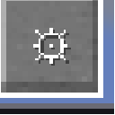
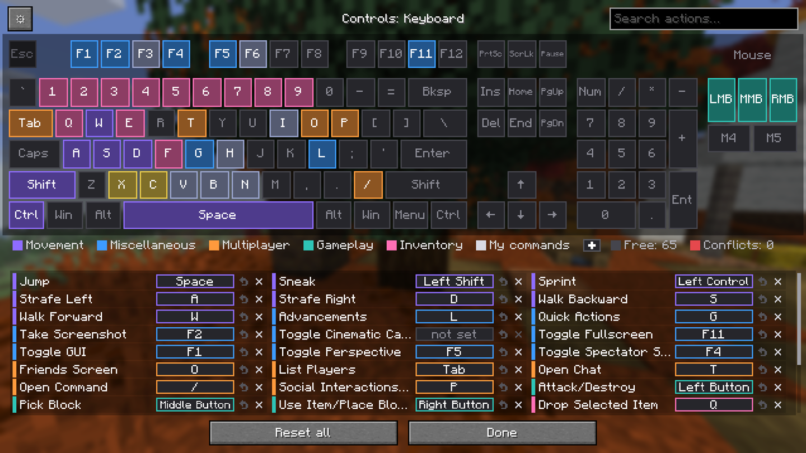
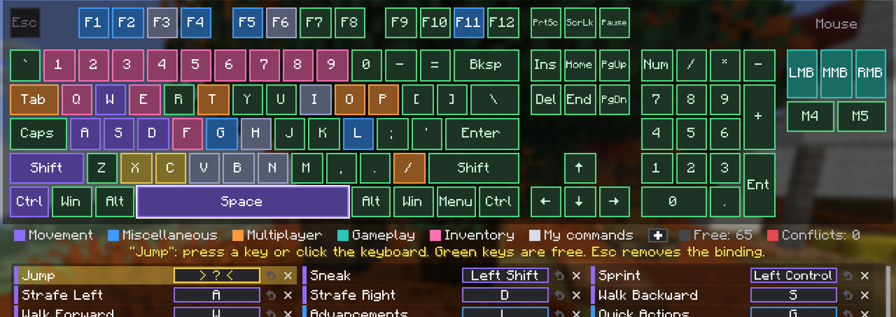
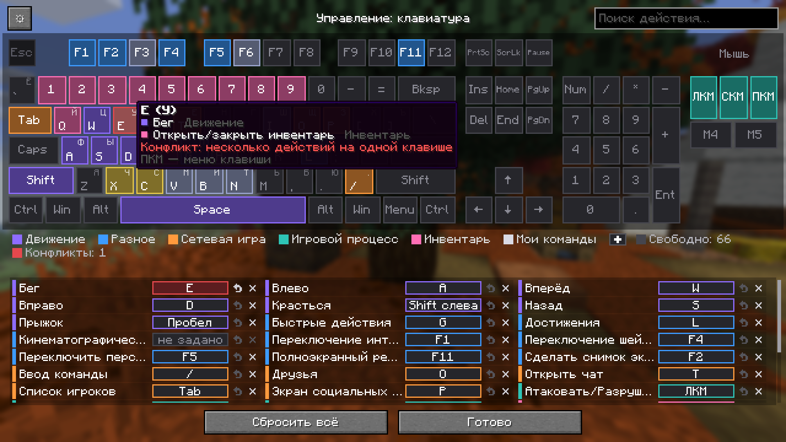
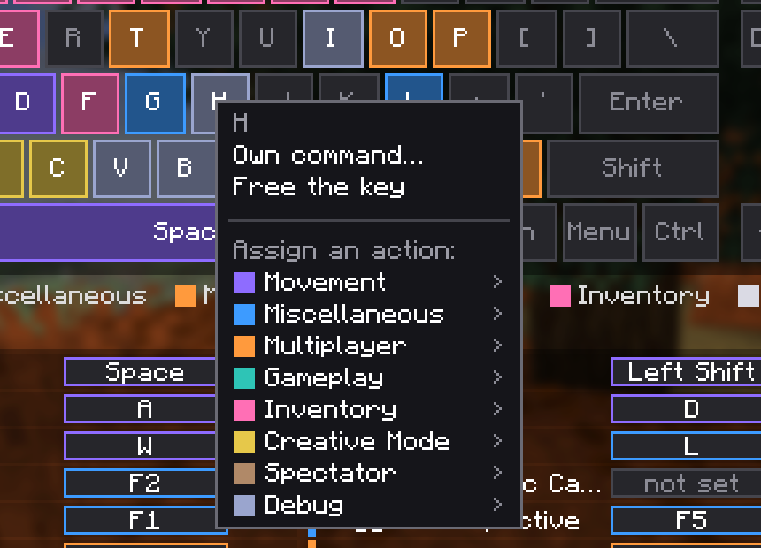
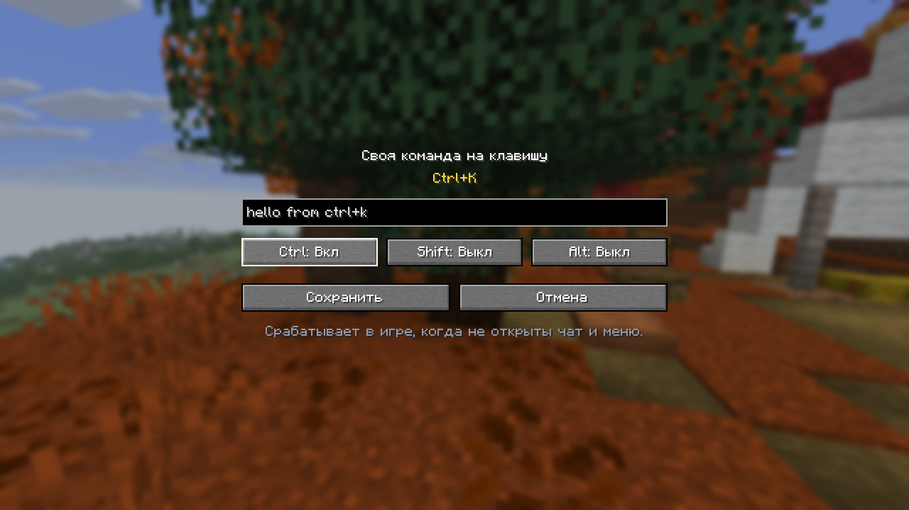
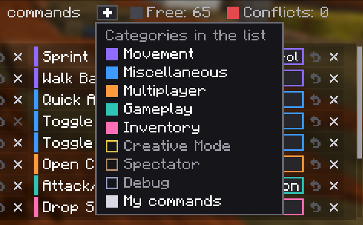
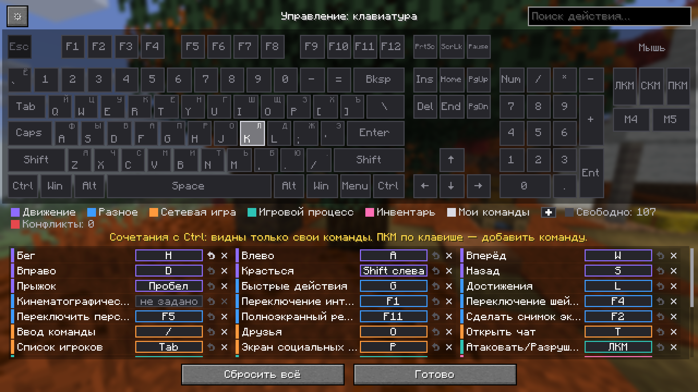
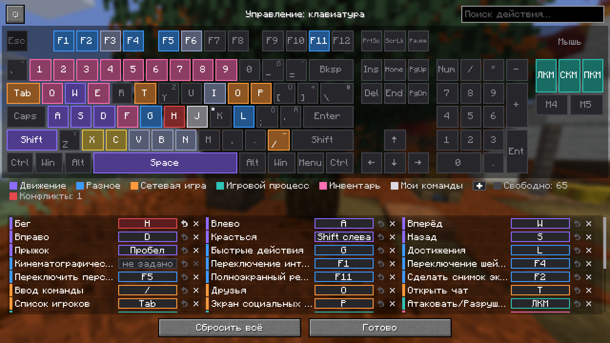

> **Language:** [Русский](README.md) · English

<div align="center">

  
  <h3>BeezzKeys (Extended)</h3>

</div>

<div align="center">


</div>

A client-side mod that turns the Key Binds screen into a drawn keyboard: you see at a glance which keys are taken, which are free and where two actions clash. Runs on **Fabric** and **NeoForge**; Fabric API and other libraries are not required.

> This mod was created and ported with the help of the AI based on the ideas of the author and viewers.

<div align="center">

  [](../../releases)

</div>

## Gallery

| Keyboard | Choosing a key |
| :---: | :---: |
|  |  |

| Conflict | Key menu |
| :---: | :---: |
|  |  |

| Own command | Categories |
| :---: | :---: |
|  |  |

| Ctrl held | Another layout |
| :---: | :---: |
|  |  |

## Features

- **Used, free and clashing keys.** A used key takes the colour of its category, a free key stays grey, and a key with two actions turns red. Keys of other mods are there too, each category gets its own colour.
- **Binding.** Click an action in the list, then press a key or click it on the drawing; free keys light up green. Or drag the action onto a key.
- **Right-click a key** for its menu: put any action of any category on it, free it, or give it your own command.
- **Your own commands.** A key can send a command (`/home`) or a chat line. Commands also take Ctrl, Shift and Alt, so `Ctrl+H` and `H` are different binds. Hold a modifier on the screen to see what is taken with it.
- **English letters first.** Keys are labelled with English letters; the letter of the game's language sits small in the corner (Й on Q for Russian, Z on Y for German). Built-in tables: Russian, Ukrainian, Belarusian, German, French, Spanish, Portuguese and Turkish; other languages use the system layout.
- **Categories.** The "+" under the keyboard chooses which categories the list shows. The keyboard itself always shows everything.
- **Gear menu.** Named sets of key binds (save, load, share as a file), a numpad switch, undo (Ctrl+Z) and the plain Minecraft list.

## Installation

The mod runs on **Fabric** and **NeoForge**. Fabric API and other libraries are not required.

1. Install [Fabric Loader](https://fabricmc.net/use/) (0.17.3 or newer) or [NeoForge](https://neoforged.net/) for Minecraft **1.21.11**.
2. Place one JAR for your loader into the `mods` folder:
   - `BeezzKeys-Fabric-1.21.11-v1.0.0.jar` for Fabric;
   - `BeezzKeys-NeoForge-1.21.11-v1.0.0.jar` for NeoForge.
3. Open **Options → Controls → Key Binds**.

The mod is only needed on the client. It works on any server and in single player.

## Controls

| Action | How |
|---|---|
| Open the keyboard | Options → Controls → Key Binds |
| Bind a key | Click an action, then press a key or click the key on the drawing |
| Drag an action | Hold an action in the list and release it on a key |
| Key menu | Right-click a key |
| Own command | Right-click a key → "Command" |
| List categories | The "+" under the keyboard |
| Sets, numpad, undo | The gear button |
| Undo the last change | Ctrl+Z |
| Plain Minecraft list | Gear → "Plain Minecraft list" |

## Good to know

- Minecraft itself has no key combinations for its actions, so Ctrl / Shift / Alt work for your own commands only.
- A command on a plain key does not replace the game's action on the same key: both fire, and the keyboard shows it as a conflict. A command on a combination hides the key press from the game.
- Commands work from the keyboard, not from mouse buttons.
- Some servers forbid macros. One command per key press is usually fine, but check the rules of your server.
- Sets are files in `config/beezzkeys/presets`, your commands and category choices are in `config/beezzkeys.json`.

## Where the settings live

- `config/beezzkeys.json` - your commands, hidden categories and the numpad switch.
- `config/beezzkeys/presets/*.json` - named sets of key binds.
- `options.txt` - the ordinary Minecraft binds, as before.

## Building

JDK 21 or newer is required.

```bash
./gradlew build
```

The command builds both files in `build/libs/`:

- `BeezzKeys-Fabric-1.21.11-v1.0.0.jar`
- `BeezzKeys-NeoForge-1.21.11-v1.0.0.jar`

Game tests with screenshots are run with `./gradlew runClientGameTest`; screenshots are saved to `build/run/clientGameTest/screenshots/`. Fabric API is only needed by those tests, the mod itself works without it.

## Other versions

Versions 1.21-26.3 live in separate branches of this repository: [1.21](../../tree/1.21), [1.21.1](../../tree/1.21.1), [1.21.2](../../tree/1.21.2), [1.21.3](../../tree/1.21.3), [1.21.4](../../tree/1.21.4), [1.21.5](../../tree/1.21.5), [1.21.6](../../tree/1.21.6), [1.21.7](../../tree/1.21.7), [1.21.8](../../tree/1.21.8), [1.21.9](../../tree/1.21.9), [1.21.10](../../tree/1.21.10), [1.21.11](../../tree/1.21.11), [26.1](../../tree/26.1), [26.1.1](../../tree/26.1.1), [26.1.2](../../tree/26.1.2), [26.2](../../tree/26.2), [26.3](../../tree/26.3). Versions below 1.21 stay unchanged in the `ports/` folder of the 26.3 branch.

## Authors and Licenses

- **Mod author:** [erkinpaw](https://github.com/erkinpaw) · **License:** [MIT](LICENSE).
- **Author of the port to Fabric/NeoForge 1.21-26.3:** [Mr712](https://github.com/byMr712/BeezzKeysExtended-MinecraftMod) · **License:** [MIT](LICENSE).
