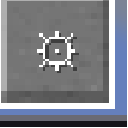
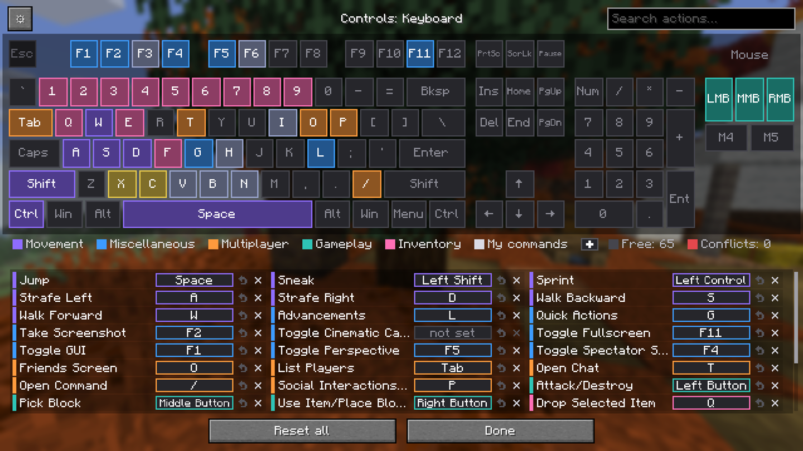
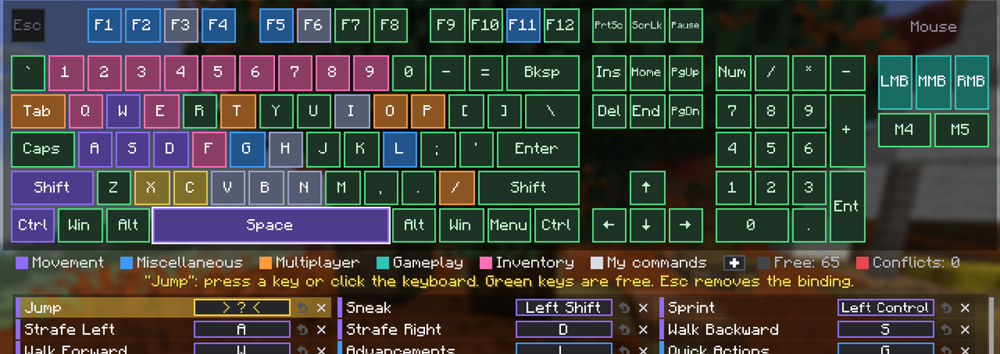
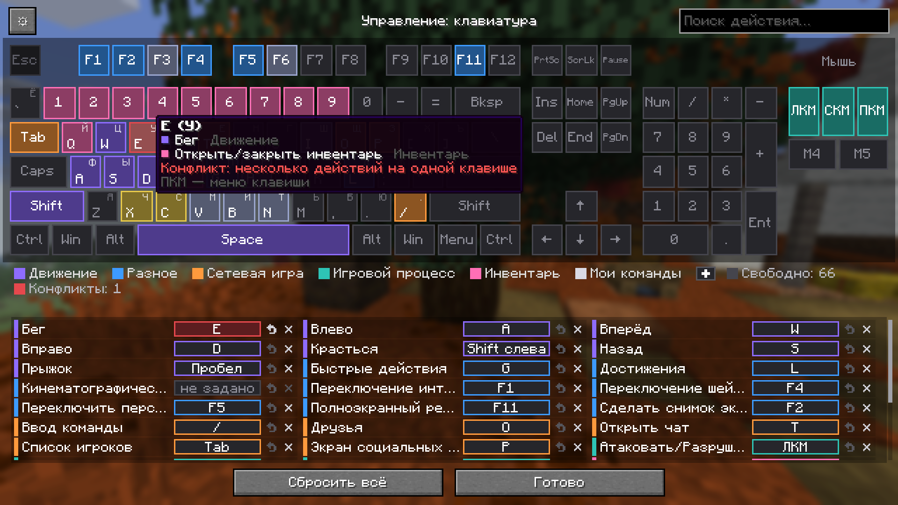
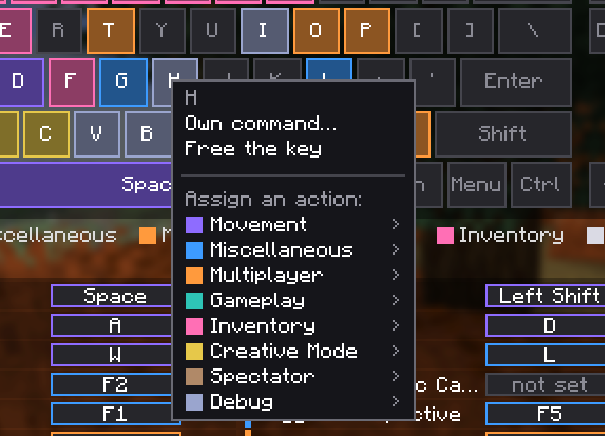
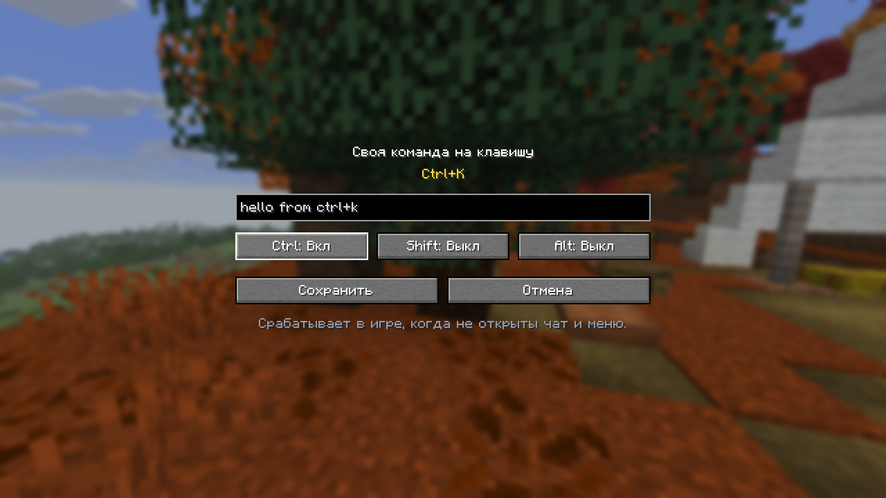
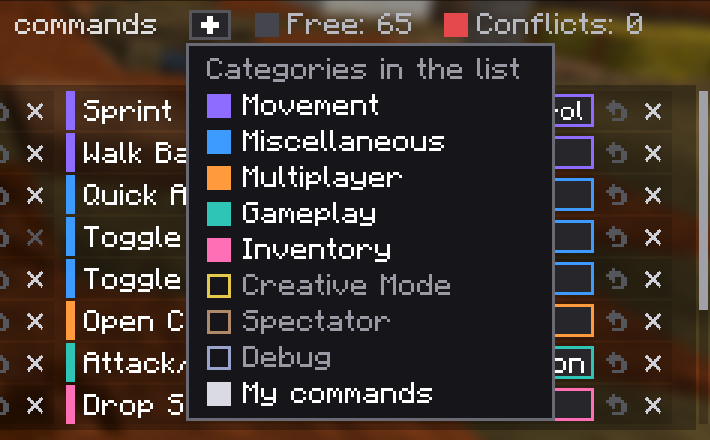
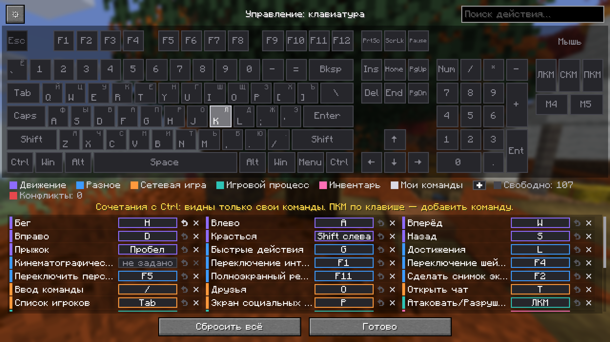
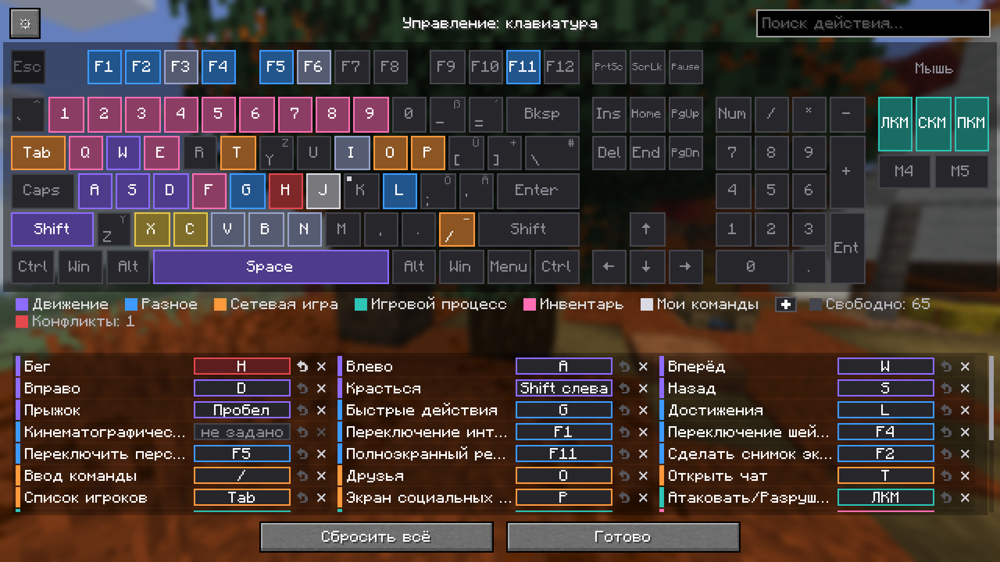

> **Language:** Русский · [English](README.en.md)

<div align="center">

  
  <h3>BeezzKeys (Extended)</h3>

</div>

<div align="center">


</div>

Клиентский мод, который превращает экран привязки клавиш в нарисованную клавиатуру: сразу видно, какие клавиши заняты, какие свободны и где две команды спорят за одну клавишу. Работает на **Fabric** и **NeoForge**, Fabric API и другие библиотеки не нужны.

> Мод сделан и портирован с помощью ИИ по идеям автора и зрителей.

<div align="center">

  [](../../releases)

</div>

## Галерея

| Клавиатура | Выбор клавиши |
| :---: | :---: |
|  |  |

| Конфликт | Меню клавиши |
| :---: | :---: |
|  |  |

| Своя команда | Категории списка |
| :---: | :---: |
|  |  |

| Ctrl удерживается | Другая раскладка |
| :---: | :---: |
|  |  |

## Возможности

- **Занятые, свободные и конфликтующие клавиши.** Занятая клавиша окрашивается в цвет своей категории, свободная остаётся серой, а клавиша с двумя действиями становится красной. Клавиши других модов тоже видны: у каждой категории свой цвет.
- **Привязка.** Нажмите на действие в списке, затем нажмите клавишу или кликните по ней на рисунке; свободные клавиши подсвечиваются зелёным. Можно и просто перетащить действие на клавишу.
- **Правая кнопка по клавише** открывает её меню: поставить на неё любое действие любой категории, освободить клавишу или назначить свою команду.
- **Свои команды.** Клавиша может отправить команду (`/home`) или строку в чат. Команды понимают Ctrl, Shift и Alt, поэтому `Ctrl+H` и `H` — разные привязки. Удерживайте модификатор на экране, чтобы увидеть, что занято с ним.
- **Английские буквы на первом плане.** Клавиши подписаны английскими буквами, а буква языка игры стоит маленькой в углу (Й на Q для русского, Z на Y для немецкого). Встроены раскладки: русская, украинская, белорусская, немецкая, французская, испанская, португальская и турецкая; остальные языки используют системную раскладку.
- **Категории.** Кнопка «+» под клавиатурой выбирает, какие категории показывать в списке. Сама клавиатура всегда показывает всё.
- **Меню-шестерёнка.** Именованные наборы привязок (сохранить, загрузить, поделиться файлом), переключатель цифрового блока, отмена (Ctrl+Z) и обычный список Minecraft.

## Установка

Мод работает на **Fabric** и **NeoForge**. Fabric API и другие библиотеки не требуются.

1. Установите [Fabric Loader](https://fabricmc.net/use/) (0.16.13 или новее) или [NeoForge](https://neoforged.net/) для Minecraft **1.21.6**.
2. Положите в папку `mods` один JAR под свой загрузчик:
   - `BeezzKeys-Fabric-1.21.6-v1.0.0.jar` — для Fabric;
   - `BeezzKeys-NeoForge-1.21.6-v1.0.0.jar` — для NeoForge.
3. Откройте **Настройки → Управление → Клавиши**.

Мод нужен только на клиенте, ставить его на сервер не надо. Он работает на любом сервере и в одиночной игре.

## Управление

| Действие | Как |
|---|---|
| Открыть клавиатуру | Настройки → Управление → Клавиши |
| Назначить клавишу | Клик по действию, затем клавиша или клик по клавише на рисунке |
| Перетащить действие | Зажать действие в списке и отпустить на клавише |
| Меню клавиши | Правая кнопка мыши по клавише |
| Своя команда | Правая кнопка по клавише → «Команда» |
| Категории списка | Кнопка «+» под клавиатурой |
| Наборы, цифровой блок, отмена | Кнопка-шестерёнка |
| Отменить последнее изменение | Ctrl+Z |
| Обычный список Minecraft | Шестерёнка → «Обычный список» |

## Полезно знать

- В Minecraft у действий игры нет сочетаний клавиш, поэтому Ctrl / Shift / Alt работают только для ваших собственных команд.
- Команда на обычной клавише не заменяет действие игры на этой же клавише: срабатывают оба, и клавиатура показывает это как конфликт. Команда на сочетании скрывает нажатие от игры.
- Команды работают с клавиатуры, но не с кнопок мыши.
- Некоторые серверы запрещают макросы. Одна команда на нажатие обычно допустима, но проверьте правила своего сервера.
- Наборы — это файлы в `config/beezzkeys/presets`, а ваши команды и выбор категорий — в `config/beezzkeys.json`.

## Где хранятся настройки

- `config/beezzkeys.json` — свои команды, скрытые категории и переключатель цифрового блока.
- `config/beezzkeys/presets/*.json` — именованные наборы привязок.
- `options.txt` — обычные привязки Minecraft, как и раньше.

## Сборка

Для сборки нужен JDK 25 или новее: Gradle и Loom работают на нём, а сам мод компилируется под Java 21. Для игры достаточно Java 21.

```bash
./gradlew build
```

Команда собирает сразу два файла в `build/libs/`:

- `BeezzKeys-Fabric-1.21.6-v1.0.0.jar`
- `BeezzKeys-NeoForge-1.21.6-v1.0.0.jar`

Игровые тесты со скриншотами запускаются командой `./gradlew runClientGameTest`, скриншоты сохраняются в `build/run/clientGameTest/screenshots/`. Fabric API нужен только для этих тестов, сам мод без него работает.

## Другие версии

Версии 1.21–26.3 живут в отдельных ветках этого репозитория: [1.21](../../tree/1.21), [1.21.1](../../tree/1.21.1), [1.21.2](../../tree/1.21.2), [1.21.3](../../tree/1.21.3), [1.21.4](../../tree/1.21.4), [1.21.5](../../tree/1.21.5), [1.21.6](../../tree/1.21.6), [1.21.7](../../tree/1.21.7), [1.21.8](../../tree/1.21.8), [1.21.9](../../tree/1.21.9), [1.21.10](../../tree/1.21.10), [1.21.11](../../tree/1.21.11), [26.1](../../tree/26.1), [26.1.1](../../tree/26.1.1), [26.1.2](../../tree/26.1.2), [26.2](../../tree/26.2), [26.3](../../tree/26.3). Версии ниже 1.21 остались без изменений в папке `ports/` ветки 26.3.

## Авторы и лицензии

- **Автор мода:** [erkinpaw](https://github.com/erkinpaw) · **Лицензия:** [MIT](LICENSE).
- **Автор порта на Fabric/NeoForge 1.21–26.3:** [Mr712](https://github.com/byMr712/BeezzKeysExtended-MinecraftMod) · **Лицензия:** [MIT](LICENSE).
